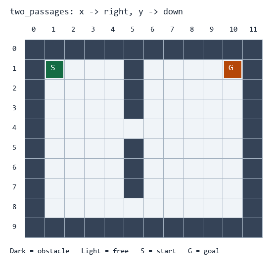

# 自主导航作业

**最终成果：** 读取给定地图，找到起点到终点的最短路径；地图出现新障碍时，复用规划程序从当前位置重新找路。

## 作业素材

| 素材 | 用途 |
| --- | --- |
| [map.json](materials/map.json) | 主地图，两条通道可绕过中间墙体 |
| [map_open.json](materials/map_open.json) | 同尺寸的简单地图，先用它调试 |
| [map_blocked.json](materials/map_blocked.json) | 两条通道都被堵住，检查无路情况 |
| [map_same_point.json](materials/map_same_point.json) | 起点等于终点，检查边界情况 |
| [updates.json](materials/updates.json) | 基于主地图依次增加障碍，用于最后一问 |



JSON 是程序输入，PNG 仅供对照。`grid` 是二维数组：0 表示空地，1 表示障碍。`start`、`goal` 都是 `[x,y]`，对应数组 `grid[y][x]`；左上角为 `[0,0]`，x 向右、y 向下。坐标单位为格。

仅允许上下左右移动，每步代价为 1。机器人暂视为一个点，不考虑身体宽度；不得斜走、越界或穿越障碍。输入保证地图为矩形，起终点位于空地。`name`、`description` 只供阅读，程序逻辑应读取地图数据。

```json
{"grid": [[0,0,0],[1,1,0],[0,0,0]], "start": [0,0], "goal": [2,2]}
```

## 第一问：读取并画出地图

**输入：** `materials/map_open.json` 和 `materials/map.json`。

**要求：** 读取地图尺寸、起点和终点；绘制格子地图，区分障碍与空地，标出 S（起点）、G（目标点） 和坐标方向。

**输出：** `outputs/q1/map_open.png`、`outputs/q1/map.png`，终端打印宽、高、起终点。

**检查：** 自己画的地图与素材预览对应，尤其确认 x/y 与行/列没有写反。图片样式不要求相同。

## 第二问：判断目标能否到达

**输入：** 主地图和无路地图。

**要求：** 实现“合法相邻格子”函数，并用广度优先搜索（BFS）从起点探索可达空地。用队列组织搜索，记录访问情况，避免重复访问。

**输出：** 每张地图一份 `outputs/q2/地图名.json`，包含布尔值 `reachable`；再画一张访问区域图。

**检查：** 主地图可达，无路地图不可达；访问区域不包含障碍和越界坐标。报告用一句话解释为什么需要记录已访问格子。

## 第三问：回溯并画出最短路径

**输入：** 第二问的地图和搜索过程。

**要求：** 搜索时记录前驱，找到目标后回溯路径；不得直接写死地图中的路线，也不能调用现成的寻路库代替核心 BFS。

**输出：** 每张地图一份 `outputs/q3/地图名.json` 和路径图。JSON 格式示例：

```json
{"found": true, "path": [[0,0],[1,0],[2,0],[2,1],[2,2]], "steps": 4}
```

该输出对应前面的 3×3 格式示例。实际路径包含起点、终点，`steps = len(path)-1`。有多条最短路径时任意一条都可以。无路时为 `{"found":false,"path":[],"steps":null}`。

**检查：** 路径从指定起点开始、在终点结束；相邻点相差一格，所有点均在空地上。解释“访问过的所有格子”和“最终路径”为什么不同。

## 第四问：用同一个程序处理四张地图

**输入：** 给定的四个地图 JSON。

**要求：** 使用同一个规划函数处理全部地图，不按地图名称分支。运行时可以更换输入路径。

**输出：** 四组路径 JSON 和结果图，放在 `outputs/q4/`，另在报告列出每张图是否找到路径、步数。

**检查：** 无路情况正常结束；起终点相同时返回 `found=true`、`path=[start]`、`steps=0`。输入文件保持原样，程序中的临时标记不写回原地图。

## 第五问：遇到新障碍，复用程序重新找路

**输入：** `materials/map.json` 和 `materials/updates.json`。

**要求：** 从主地图开始，按 `updates` 数组顺序处理事件。每次将 `add_obstacles` 中的格子置为障碍，以事件的 `current` 为新起点，目标保持主地图的 `goal`；障碍累积保留。复用第三问的规划函数。

**输出：** `outputs/q5/replans.json`（每个事件一项，包含 `id`、`found`、`path`、`steps`），以及每次更新后的地图与路径图。

**检查：** 第一次堵住上方通道后，应找到另一条路线；第二次再堵住下方通道，应明确报告无路，不能继续返回旧路径。起点应是事件中的当前位置，而不是主地图原起点。

这一步只做地图更新后的重新规划，不要求编写移动动画、物理仿真或机器人运动控制。想进一步尝试可自行比较 A*，不计入必做内容。


## 提交与验收

将本仓库fork到自己的github账户下，在分支仓库中提交编写的源码、依赖说明、实际输出和填写后的 [REPORT.md](REPORT.md)。源码可以放在 `src/`，输出放在 `outputs/`。保留题目和原始素材，新增自己的实现。
